 

 

  

 

---

<!-- ═══════════════════ PROFILE (ASCII + NEOFETCH, ONE CARD) ═══════════════════ -->

  

    
    
    
    profile — neofetch
  

  

<table>
<tr>
<td width="42%" valign="top" align="center">

</td>
<td width="58%" valign="top">

<pre style="background:transparent; margin:0; font-family:'Fira Code',monospace; font-size:13px; line-height:1.6; color:#B5D4F4;">
daniel@github
─────────────────────────────────────────
Name       Daniel Franco
Location   Cartagena, Colombia 🇨🇴
University Universidad de Cartagena
Degree     Systems Engineering
Status     Student — building every day 🚀
Focus      Full-Stack · Systems · AI & CV
Languages  Python · TypeScript · C++
           JavaScript · Go · SQL
─────────────────────────────────────────
Philosophy
"No es necesario que des una respuesta
 ahora mismo... Pero no dejes de avanzar
 hasta que la encuentres."
 — Aoi Todo
</pre>

</td>
</tr>
</table>

  

---

<!-- ═══════════════════ TECH STACK ═══════════════════ -->

  

    
    
    
    tech-stack — bash
  

  

**Languages**

**Frameworks, Tools & Environment**

  

---

<!-- ═══════════════════ FEATURED PROJECTS ═══════════════════ -->

  

    
    
    
    featured-projects — ls
  

  

<table>
<tr>
<td width="50%" valign="top">

### 🚑 [project_Flowsense](https://github.com/nosedimetuXD/project_Flowsense)

**Percepción de tráfico en tiempo real con OpenCV 5**

Sistema de visión por computador para enrutar de forma dinámica vehículos de emergencia (ambulancias y bomberos) — OpenCV AI Competition 2026 (AWS).

**Highlights:**
- 🚦 Detección y percepción en tiempo real con OpenCV
- 📍 Optimización dinámica de rutas de emergencia
- ☁️ Arquitectura desplegada e integrada con AWS
- ⚡ Procesamiento de flujo de video con baja latencia

</td>
<td width="50%" valign="top">

### 🏛️ [CEIS_HUB](https://github.com/nosedimetuXD/CEIS_HUB)

**Plataforma oficial estudiantil de Ing. de Sistemas**

Aplicativo web intuitivo y robusto para la comunidad académica de Ingeniería de Sistemas de la Universidad de Cartagena, administrado por el CEIS.

**Highlights:**
- 🎓 Portal informativo centralizado para estudiantes
- ⚡ Interfaz moderna y reactiva construida con TypeScript
- 📱 Experiencia optimizada para móviles y desktop
- 👥 Gestión de eventos, avisos y recursos académicos

</td>
</tr>
<tr>
<td width="50%" valign="top">

### ☕ [Toffee](https://github.com/nosedimetuXD/Toffee)

**Sistema Web & PWA para gestión de cafetería y POS**

Hecho por y para estudiantes. Sistema POS multiusuario, comandas en tiempo real, control de inventario/mermas y contabilidad avanzada.

**Highlights:**
- 🛒 Punto de venta (POS) multiusuario en tiempo real
- 📦 Control de stock, inventario y registro de mermas
- 📊 Reportes financieros y contabilidad avanzada
- 🌐 PWA instalable con funcionamiento rápido

</td>
<td width="50%" valign="top">

### ⚛️ [HPC-Studio](https://github.com/nosedimetuXD/HPC-Studio)

**High Performance Computing & Quantum Simulation Studio**

Plataforma interactiva para computación de alto rendimiento y simulación cuántica, diseñada para experimentación y cálculos complejos.

**Highlights:**
- 🔬 Simulador y entorno para circuitos y algoritmos cuánticos
- 🖥️ Interfaz de usuario interactiva y fluida
- ⚙️ Backend de alto rendimiento para cómputo intensivo

</td>
</tr>
</table>

  

---

<!-- ═══════════════════ MAIN REPO / WORKSPACE TREE ═══════════════════ -->

  

    
    
    
    workspace — tree
  

  

> 🚀 **Ingeniería de Sistemas — Universidad de Cartagena** · Proyectos activos, investigación y desarrollo.

<pre style="background:transparent; margin:0; font-family:'Fira Code',monospace; font-size:13px; line-height:1.55; color:#B5D4F4;">
nosedimetuXD/
├── Computer-Vision-AI/
│   ├── project_Flowsense (OpenCV 5 · Emergency Traffic Perception)
│   └── Video Stream Processing &amp; AWS Deployment
│
├── Web-Apps-Platforms/
│   ├── CEIS_HUB (Portal Estudiantil · Universidad de Cartagena)
│   ├── Toffee (POS &amp; Cafetería · React + Go + Postgres)
│   └── Hackathon-CTW-Arepa-Tech
│
├── Systems-HPC/
│   ├── HPC-Studio (Quantum Simulation &amp; Parallel Computing)
│   ├── HPC-Studio-Backend
│   └── GamepadMapperLib (C++ Input Controller Library)
│
└── University-Academia/
    ├── Proyecto-corte-1-Automatas
    └── Proyecto-Carro-Pasco
</pre>

  

---

<!-- ═══════════════════ GITHUB STATS ═══════════════════ -->

  

    
    
    
    stats — github-stats
  

  

  

  

---

<!-- ═══════════════════ CONTRIBUTION GRAPH ═══════════════════ -->

  

    
    
    
    contributions — git log
  

  

  

---

<!-- ═══════════════════ FOOTER ═══════════════════ -->

 

> *"No es necesario que des una respuesta ahora mismo... Pero no dejes de avanzar hasta que la encuentres."*
>
> — **Aoi Todo**

 

&nbsp;

&nbsp;

 

